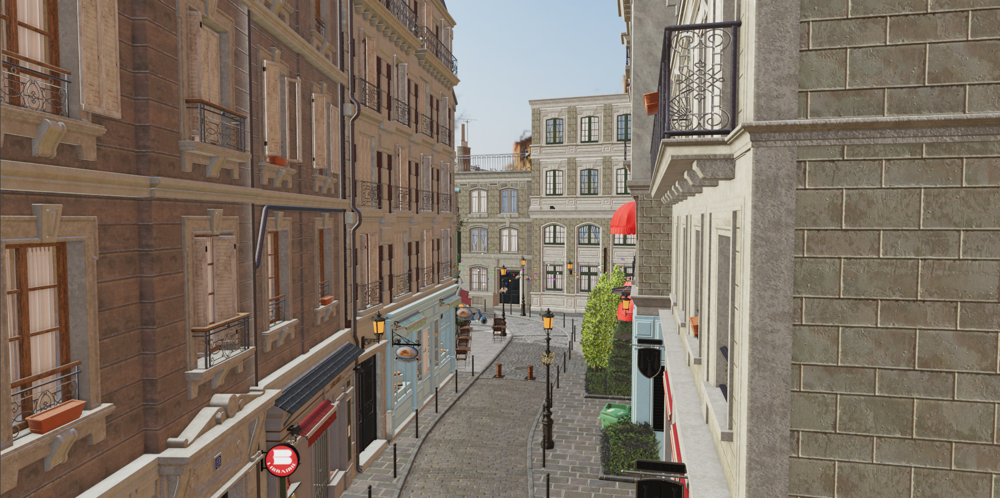
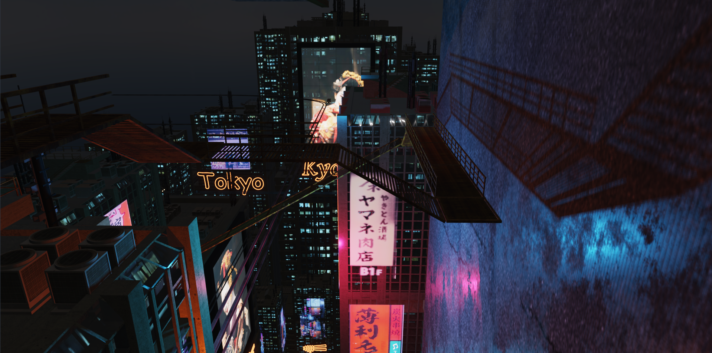
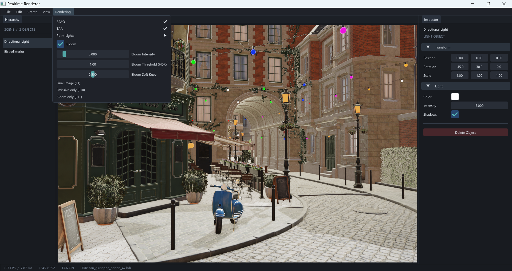
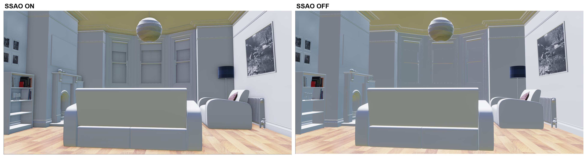
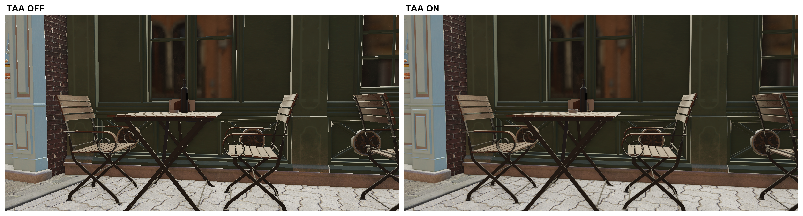
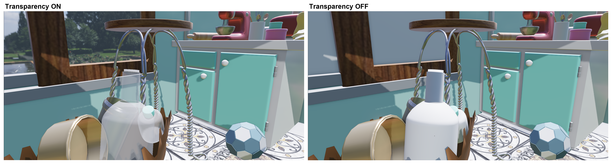
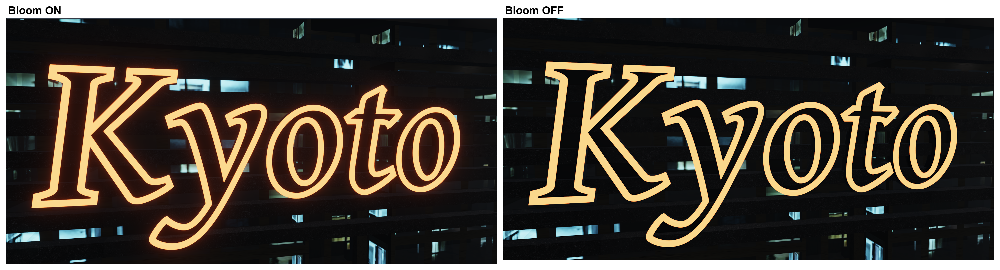
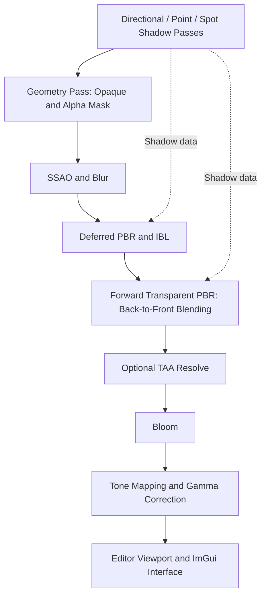

# Realtime Renderer

[English](README.md) | [简体中文](README.zh-CN.md)

A real-time PBR renderer built with **C++20 and OpenGL 4.5**, featuring deferred lighting, image-based lighting, shadows, temporal anti-aliasing, transparency, and an interactive scene editor.

This personal graphics project explores how rendering techniques work together in a complete pipeline, from asset loading and material evaluation to lighting, post-processing, and object selection. Models and HDR environments can be imported at runtime without a predefined scene.

## Showcase

Images below were captured in this renderer. Scene models and textures are third-party assets; credits are listed at the end of this document.

### Scene Rendering

**Amazon Lumberyard Bistro**



**Neon Descent — Galaziart**



### Interactive Editor

Dockable scene hierarchy, viewport, and Inspector, with editable lights, materials, transforms, and rendering settings.



### SSAO — ON / OFF

Contact shading and local occlusion in the Kitchen scene. **Left: ON. Right: OFF.**



### TAA — OFF / ON

A static comparison of fine geometry edges in Bistro. **Left: OFF. Right: ON.** Temporal stability during camera motion is not demonstrated by these still images.



### Transparency — ON / OFF

Alpha-blended glass surfaces in Kitchen. **Left: ON. Right: OFF.** This demonstrates alpha blending; transmission and refraction are not implemented.



### Bloom — ON / OFF

Bloom adds a soft halo around emissive signage in Neon Descent. **Left: ON. Right: OFF.** The original captures have a slight camera offset.



## Features

### Materials and Lighting

- Metallic-Roughness PBR with Cook-Torrance specular reflection, GGX, Smith masking-shadowing, and Schlick Fresnel.
- Base color, normal, metallic-roughness, ambient occlusion, and emissive textures with material factors.
- Image-based lighting: HDR-to-cubemap conversion, irradiance convolution, environment prefiltering, and a BRDF integration LUT.
- Directional, point, and spot lights with editable parameters.
- Deferred lighting for opaque and alpha-masked geometry.
- A separate forward PBR pass for alpha-blended geometry, including environment reflections and shadow reception.

### Shadows and Post-processing

- Four-cascade directional shadow maps, with filtering, receiver-plane depth correction, and distance fading.
- Cubemap-array point shadows and 2D-array spot shadows.
- A configurable point-light shadow budget.
- Screen-space ambient occlusion and a blur pass, with a runtime toggle.
- Temporal anti-aliasing with projection jitter, motion vectors, history reprojection, depth rejection, neighborhood color clamping, and history accumulation.
- HDR rendering, Reinhard / ACES-style tone mapping, and gamma correction.
- Multi-resolution Bloom with downsampling, upsampling, and adjustable intensity, threshold, and soft knee.

### Assets and Editor

- glTF / GLB loading through fastgltf, with an additional Assimp loading path.
- KTX2 / Basis texture loading and transcoding.
- Runtime model and HDR import through the File menu.
- A dockable Dear ImGui editor with Hierarchy, Viewport, Inspector, and a status bar.
- Object and material picking, including transparent surfaces.
- Transform controls and ImGuizmo translation, rotation, and scale tools.
- Material editing, light creation and deletion, and a free-flight camera.
- Debug views for albedo, normals, metallic, roughness, AO, depth, SSAO, velocity, emissive output, and Bloom.

## Rendering Pipeline



Before transparency is rendered, opaque depth is copied to the scene framebuffer. Transparent meshes are sorted by their centers in view space and blended with depth testing enabled and depth writes disabled.

When the viewport is clicked, an additional transparent picking pass writes object and material IDs. This pass runs after image rendering and does not contribute to the displayed color.

## Implementation Highlights

### Temporal Anti-aliasing

The geometry pass records current and previous clip-space positions to generate motion vectors. TAA reprojects history into the current frame and uses depth rejection and neighborhood color clamping to limit invalid history. History is also invalidated when appropriate, including after an HDR environment change.

### Cascaded Shadow Maps

The camera frustum is divided into four cascades to allocate directional shadow coverage across viewing distances. World-position derivatives estimate receiver-plane depth changes in shadow space, reducing self-shadowing artifacts during filtered sampling.

### Deferred and Forward Rendering

Opaque surfaces store material information in the G-buffer for deferred lighting. Transparent surfaces are shaded and blended separately. Both paths use PBR lighting and share scene lights, environment maps, and shadow resources.

## Building and Running

### Requirements

- Windows. The current build links against `comdlg32` for native file dialogs.
- A GPU and driver supporting OpenGL 4.5 Core.
- Visual Studio 2022 with Desktop Development with C++ and the Windows SDK.
- CMake 3.20 or later and Ninja.
- Python for dependency generation, and Bash for KTX-Software; Git for Windows can provide Bash.

The latest local build was verified with MSVC and an x64 Debug configuration on Windows. Other platforms have not been tested.

### Dependencies

CMake builds dependencies from the local `external/` directory. Automatic dependency downloads are not configured. The entire directory, including `stb_image.h`, is excluded from Git. A fresh clone therefore requires the dependency sources to be supplied before configuring.

| Directory | Purpose |
| --- | --- |
| `external/glfw` | Window creation and input |
| `external/glad` | OpenGL function loading and build-time generation |
| `external/glm` | Vector and matrix mathematics |
| `external/assimp` | Model loading |
| `external/fastgltf` | glTF / GLB parsing |
| `external/simdjson` | JSON parsing dependency |
| `external/KTX-Software` | KTX2 / Basis texture processing |
| `external/imgui` | Editor UI; a version with docking support is required |
| `external/ImGuizmo` | Transform gizmos |
| `external/stb` | Image decoding |

Keep any submodules and supporting files required by these dependencies. The current GLM layout places `glm.hpp` directly at `external/glm/glm.hpp`; the root CMake file accommodates this layout. Dependency version pinning and a reproducible setup procedure remain to be documented.

### Build

After preparing the dependencies, open **x64 Native Tools Command Prompt for VS 2022**, change to the repository root, and run:

```bat
cmake -S . -B build -G Ninja -DCMAKE_BUILD_TYPE=Debug
cmake --build build --target renderer --parallel 4
```

Launch from the repository root:

```bat
build\renderer.exe
```

Shader paths are relative to the working directory. When debugging in Visual Studio, set the working directory to the repository root as well.

CMake copies `shaders/` next to the executable and also copies `assets/` if that directory exists locally. The executable can therefore also be launched with its containing directory as the working directory, after the required files have been copied.

### Importing a Scene

The application starts with an empty scene and one default directional light. No model or HDR file is required at startup.

1. Choose **File > Import Model...** to load a `.gltf` or `.glb` model. The camera automatically frames the imported model.
2. Choose **File > Import HDR...**, directly below model import, to load an equirectangular `.hdr` environment and generate its background and IBL maps.
3. Adjust materials and lights in the Inspector, or add lights through the Create menu.

Before an HDR is loaded, the background is black and environment lighting is zero; direct lighting remains available. Canceling import or failing to decode a file preserves the existing environment. IBL generation runs on the main thread and may briefly pause the application. The BRDF LUT is generated once during initialization and reused across environment changes.

Models and HDR files can be imported from local folders outside the repository. For glTF assets with external textures or buffers, preserve their relative directory structure. The local `assets/` directory is excluded from Git.

## Controls

| Input | Action |
| --- | --- |
| Right-click in the viewport | Enter or leave camera control |
| Mouse movement | Look around while controlling the camera |
| W / A / S / D | Move forward, left, backward, and right in camera mode |
| Space / Left Ctrl | Move up / down in camera mode |
| Shift | Increase camera movement speed |
| Mouse wheel | Adjust the camera field of view |
| F12 / View > Fullscreen Viewport | Toggle a viewport that fills the application content area; restore the editor panels when toggled off |
| Esc | Release camera control first, leave fullscreen viewport next, or exit in the normal editor layout |
| Left-click a surface | Select its object and material |
| Hierarchy selection | Select an object; in Edit Mode, frame a selected model |
| Edit > Edit Mode | Enable transform editing |
| W / E / R | Translate / rotate / scale in Edit Mode, with the pointer over the viewport and camera control inactive |
| Delete | Delete the selected object when text or property editing is inactive |
| Create menu | Add directional, point, or spot lights |
| File > Import Model... / Import HDR... | Import a model / replace the HDR environment |
| Rendering menu | Toggle SSAO and TAA; configure Bloom and the point-light shadow budget |

The following shortcuts are active while camera control is enabled:

| Key | View or Setting |
| --- | --- |
| F1 | Final image |
| F2 / F3 | Albedo / world-space normals |
| F4 / F5 / F6 | Metallic / roughness / material AO |
| F7 / F8 / F9 | Depth / SSAO / motion vectors |
| F10 / F11 | Emissive / Bloom |
| 1 / 2 | Reinhard / ACES-style tone mapping |

## Project Structure

```text
RealtimeRender/
+-- CMakeLists.txt
+-- include/            Class declarations
+-- src/                C++ implementation and editor entry point
+-- shaders/            GLSL shaders
+-- external/           Local dependencies, excluded from Git
+-- assets/             Optional local scene assets, excluded from Git
+-- docs/images/        Showcase screenshots and ON/OFF comparisons
```

Rendering passes are implemented in `src/Renderer.cpp`; asset loading in `src/GltfLoader.cpp` and `src/Model.cpp`; environment processing in `src/EnvironmentMap.cpp`. Application initialization and the editor UI are in `src/main.cpp`.

## Current Limitations

- Transparency is sorted by mesh centers. Intersecting transparent geometry and ordering within individual meshes can produce artifacts.
- Transparent color is blended before TAA, but transparent layers do not have independent depth or motion vectors. Camera or transparent-object motion can still produce reprojection artifacts.
- Transparency implements glTF `alphaMode = BLEND`; transmission, refraction, and volume absorption are not implemented.
- Asset loading focuses on static scenes and Metallic-Roughness materials; full glTF feature and extension coverage is not claimed.
- SSAO uses the opaque G-buffer and is not applied to transparent surfaces.
- Lighting is currently limited to 4 directional and 4 point lights. The deferred shader evaluates up to 4 spot lights; the transparent shader evaluates up to 10.
- Emissive materials contribute to surface color and Bloom, but do not automatically illuminate surrounding geometry.
- Scene saving and loading are not implemented. No standardized performance benchmark is provided; status-bar frame time measures the overall frame, not individual GPU passes.

## Asset Credits

Third-party scene models, textures, HDR environments, and libraries remain the work of their respective authors. This project's contribution is the renderer and its integration of rendering techniques, asset loading, and editor interaction.

### Showcase Scenes

| Asset | Author | Source | License |
| --- | --- | --- | --- |
| Amazon Lumberyard Bistro | Amazon Lumberyard | [NVIDIA ORCA](https://developer.nvidia.com/orca/amazon-lumberyard-bistro) | [CC BY 4.0](https://creativecommons.org/licenses/by/4.0/) |
| Neon Descent (Special Free Release) | Galaziart | [Fab](https://www.fab.com/listings/11bd4091-7daa-48f3-941f-2947450f6352) | Subject to the license supplied when the asset was acquired; no CC license is asserted here. |
| Kitchen | Montassar-f | [Sketchfab](https://sketchfab.com/3d-models/kitchen-81751241cd5a4ebc805c8eb100e8b50c) | [CC BY 4.0](https://creativecommons.org/licenses/by/4.0/) |

The local Bistro package is a glTF conversion of the original FBX scene, with KTX2 textures. Neon Descent is supplied as a Blender scene and is used through a local glTF/GLB export. Original scene files are not included in this repository; obtain assets from their source pages under the applicable terms.

### HDR Environments

Local test assets include [San Giuseppe Bridge](https://polyhaven.com/a/san_giuseppe_bridge) and [Symmetrical Garden](https://polyhaven.com/a/symmetrical_garden), by Greg Zaal, from Poly Haven under [CC0](https://polyhaven.com/license). Source pages retain the full asset credits.

### Code and Dependencies

The renderer uses established PBR, IBL, shadow mapping, SSAO, TAA, and Bloom techniques. Third-party dependencies retain their own licenses and copyright notices. No project-wide source-code license has been declared in this repository.
