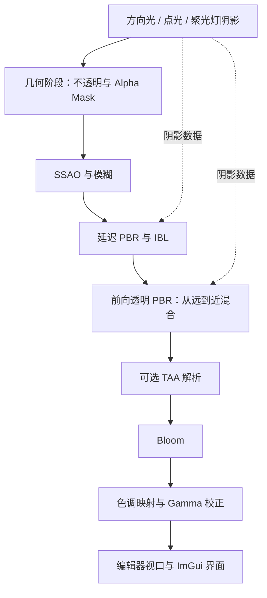

# Realtime Renderer

[English](README.md) | [简体中文](README.zh-CN.md)

基于 **C++20 和 OpenGL 4.5** 的实时 PBR 渲染器，包含延迟光照、基于图像的光照、阴影、时间抗锯齿、透明绘制和交互式场景编辑器。

这是一个个人图形学项目，用于探索不同渲染技术如何在完整管线中协同工作，涵盖资产加载、材质计算、光照、后处理和物体选择。模型和 HDR 环境可以在运行时导入，无需预设场景。

## 效果展示

发布前将补充截图与演示视频，包括编辑器操作以及 TAA、SSAO 和 Bloom 的效果对比。

## 功能

### 材质与光照

- Metallic-Roughness PBR：使用 Cook-Torrance 镜面反射、GGX、Smith 遮蔽与阴影项，以及 Schlick Fresnel。
- 支持基础颜色、法线、金属度与粗糙度、环境遮蔽和自发光纹理，以及对应的材质系数。
- 基于图像的光照（IBL）：HDR 转立方体贴图、辐照度卷积、环境贴图预过滤和 BRDF 积分查找表。
- 可编辑参数的方向光、点光和聚光灯。
- 不透明与 Alpha Mask 几何使用延迟光照。
- Alpha Blend 几何使用独立的前向 PBR 绘制，支持环境反射和接收阴影。

### 阴影与后处理

- 四级方向光级联阴影，包含阴影过滤、接收面深度修正和距离淡出。
- 基于立方体贴图数组的点光阴影，以及基于二维贴图数组的聚光灯阴影。
- 可配置点光源阴影预算。
- 屏幕空间环境遮蔽（SSAO）及模糊处理，支持运行时开关。
- 时间抗锯齿（TAA）：投影抖动、运动向量、历史重投影、深度拒绝、邻域颜色限制和历史累积。
- HDR 渲染、Reinhard / ACES 风格色调映射和 Gamma 校正。
- 多分辨率 Bloom，使用降采样与升采样，可调节强度、阈值和软过渡范围（Soft Knee）。

### 资产与编辑器

- 通过 fastgltf 加载 glTF / GLB，同时保留 Assimp 加载路径。
- KTX2 / Basis 纹理加载与转码。
- 通过 File 菜单在运行时导入模型和 HDR。
- 基于 Dear ImGui 的可停靠编辑器，包含 Hierarchy、Viewport、Inspector 和状态栏。
- 物体与材质拾取，包括透明表面。
- 变换参数编辑，以及 ImGuizmo 平移、旋转和缩放工具。
- 材质编辑、灯光创建与删除、自由相机。
- Albedo、Normal、Metallic、Roughness、AO、Depth、SSAO、Velocity、Emissive 和 Bloom 调试视图。

## 渲染管线



透明绘制前，将不透明深度复制到场景帧缓冲。透明 mesh 根据中心在观察空间中的深度排序，在开启深度测试、关闭深度写入的情况下进行混合。

点击视口时，额外执行透明拾取绘制，写入物体 ID 和材质 ID。该步骤位于图像渲染之后，不参与显示颜色的计算。

## 实现重点

### 时间抗锯齿

几何阶段记录当前与上一帧的裁剪空间位置，用于生成运动向量。TAA 将历史数据重投影到当前帧，结合深度拒绝和邻域颜色限制减少无效历史的影响。在必要时重置历史，例如切换 HDR 环境之后。

### 级联阴影

相机视锥划分为四级，为不同观察距离分配方向光阴影覆盖范围。通过世界空间位置的导数估计接收面在阴影空间中的深度变化，以减轻过滤采样时的自阴影伪影。

### 延迟与前向绘制

不透明表面将材质信息写入 G-buffer，供延迟光照使用。透明表面则单独计算光照并混合。两条路径都使用 PBR 光照，并共享场景灯光、环境贴图和阴影资源。

## 构建与运行

### 环境要求

- Windows。当前构建链接 `comdlg32`，用于原生文件对话框。
- 支持 OpenGL 4.5 Core 的显卡与驱动。
- Visual Studio 2022，安装“使用 C++ 的桌面开发”及 Windows SDK。
- CMake 3.20 或更高版本，以及 Ninja。
- 依赖生成所需的 Python，以及 KTX-Software 所需的 Bash；Git for Windows 可以提供 Bash。

最近一次本地构建验证使用 Windows、MSVC 和 x64 Debug 配置。其他平台尚未测试。

### 依赖

CMake 从本地 `external/` 目录构建依赖，目前没有配置自动下载。整个目录（包括 `stb_image.h`）均不纳入 Git。因此，首次克隆仓库后，需要先准备依赖源码，再进行配置。

| 目录 | 用途 |
| --- | --- |
| `external/glfw` | 窗口创建与输入 |
| `external/glad` | OpenGL 函数加载与构建时生成 |
| `external/glm` | 向量与矩阵计算 |
| `external/assimp` | 模型加载 |
| `external/fastgltf` | glTF / GLB 解析 |
| `external/simdjson` | JSON 解析依赖 |
| `external/KTX-Software` | KTX2 / Basis 纹理处理 |
| `external/imgui` | 编辑器界面，需要包含 Docking 支持的版本 |
| `external/ImGuizmo` | 变换操作工具 |
| `external/stb` | 图像解码 |

请保留各依赖需要的子模块与附带文件。当前 GLM 布局将 `glm.hpp` 直接放在 `external/glm/glm.hpp`，根目录的 CMake 文件对此做了适配。依赖版本固定和可复现的配置流程仍待整理。

### 编译

准备好依赖后，打开 **x64 Native Tools Command Prompt for VS 2022**，进入仓库根目录并执行：

```bat
cmake -S . -B build -G Ninja -DCMAKE_BUILD_TYPE=Debug
cmake --build build --target renderer --parallel 4
```

在仓库根目录启动：

```bat
build\renderer.exe
```

Shader 路径相对于工作目录解析。在 Visual Studio 中调试时，也请将工作目录设为仓库根目录。

CMake 会将 `shaders/` 复制到可执行文件旁；本地存在 `assets/` 时，也会复制该目录。因此，在必要文件复制完成后，也可以将可执行文件所在目录作为工作目录启动程序。

### 导入场景

程序以空场景启动，保留一盏默认方向光，启动时无需模型或 HDR 文件。

1. 选择 **File > Import Model...**，加载 `.gltf` 或 `.glb` 模型。相机会自动调整位置以容纳导入的模型。
2. 选择模型导入下方的 **File > Import HDR...**，加载等距柱状投影的 `.hdr` 环境图，生成背景和 IBL 贴图。
3. 在 Inspector 中调整材质与灯光，或通过 Create 菜单添加灯光。

未加载 HDR 时，背景为黑色，环境光照为零，直接光照仍可使用。取消导入或文件解码失败时保留现有环境。IBL 在主线程生成，可能使程序短暂停顿。BRDF LUT 在初始化时生成一次，切换环境时复用。

模型和 HDR 可以从仓库外的本地目录导入。对于带外部纹理或缓冲文件的 glTF 资产，需要保留其相对目录结构。本地 `assets/` 目录未纳入 Git。

## 操作说明

| 输入 | 操作 |
| --- | --- |
| 视口内右键 | 进入或退出相机控制 |
| 鼠标移动 | 控制相机时转动视角 |
| W / A / S / D | 相机模式下向前、向左、向后、向右移动 |
| Space / 左 Ctrl | 相机模式下向上 / 向下移动 |
| Shift | 加快相机移动 |
| 鼠标滚轮 | 调整相机视场角 |
| F12 / View > Fullscreen Viewport | 切换视口铺满程序内容区，再次切换恢复编辑器面板 |
| Esc | 优先释放相机控制，其次退出视口全屏；普通编辑器布局下退出程序 |
| 左键点击表面 | 选择对应物体和材质 |
| Hierarchy 列表选择 | 选择物体；编辑模式下会聚焦所选模型 |
| Edit > Edit Mode | 开启变换编辑 |
| W / E / R | 编辑模式下切换平移 / 旋转 / 缩放，需要鼠标位于视口内且未控制相机 |
| Delete | 未编辑文本或参数时，删除选中物体 |
| Create 菜单 | 添加方向光、点光或聚光灯 |
| File > Import Model... / Import HDR... | 导入模型 / 替换 HDR 环境 |
| Rendering 菜单 | 开关 SSAO、TAA，配置 Bloom 和点光源阴影预算 |

以下快捷键在相机控制模式下生效：

| 按键 | 视图或设置 |
| --- | --- |
| F1 | 最终画面 |
| F2 / F3 | Albedo / 世界空间法线 |
| F4 / F5 / F6 | 金属度 / 粗糙度 / 材质 AO |
| F7 / F8 / F9 | 深度 / SSAO / 运动向量 |
| F10 / F11 | 自发光 / Bloom |
| 1 / 2 | Reinhard / ACES 风格色调映射 |

## 项目结构

```text
RealtimeRender/
+-- CMakeLists.txt
+-- include/            类声明
+-- src/                C++ 实现与编辑器入口
+-- shaders/            GLSL 着色器
+-- external/           本地依赖，未纳入 Git
+-- assets/             可选的本地场景资产，未纳入 Git
```

渲染阶段实现在 `src/Renderer.cpp`；资产加载位于 `src/GltfLoader.cpp` 和 `src/Model.cpp`；环境处理位于 `src/EnvironmentMap.cpp`。应用初始化和编辑器界面位于 `src/main.cpp`。

## 当前限制

- 透明绘制根据 mesh 中心排序，交叉透明几何和单个 mesh 内部的顺序可能产生伪影。
- 透明颜色在 TAA 前混合，但透明层没有独立的深度和运动向量；移动镜头或透明物体时，仍可能出现重投影伪影。
- 透明材质实现 glTF `alphaMode = BLEND`，未实现透射、折射与体积吸收。
- 资产加载重点为静态场景和 Metallic-Roughness 材质，不声称完整覆盖所有 glTF 功能与扩展。
- SSAO 使用不透明 G-buffer，不应用于透明表面。
- 当前最多计算 4 个方向光和 4 个点光。延迟 Shader 最多计算 4 个聚光灯，透明 Shader 最多计算 10 个聚光灯。
- 自发光材质影响表面颜色和 Bloom，但不会自动照亮周围几何。
- 未实现场景保存与恢复，尚无统一的性能基准。状态栏帧耗时反映整帧表现，不是各 GPU Pass 的独立计时。

## 参考资料与资产致谢

渲染器实现了 PBR、IBL、阴影映射、SSAO 和 TAA 等已有技术。第三方模型、HDR 环境和库属于各自作者；场景资产不作为本项目的原创建模成果。

### 展示场景

| 资产 | 作者 | 来源 | 许可证 |
| --- | --- | --- | --- |
| Amazon Lumberyard Bistro | Amazon Lumberyard | [NVIDIA ORCA](https://developer.nvidia.com/orca/amazon-lumberyard-bistro) | [CC BY 4.0](https://creativecommons.org/licenses/by/4.0/) |
| Neon Descent (Special Free Release) | Galaziart | [Fab](https://www.fab.com/listings/11bd4091-7daa-48f3-941f-2947450f6352) | 遵循获取资产时随附的许可证，此处不声称其采用 CC 许可证。 |
| Kitchen | Montassar-f | [Sketchfab](https://sketchfab.com/3d-models/kitchen-81751241cd5a4ebc805c8eb100e8b50c) | [CC BY 4.0](https://creativecommons.org/licenses/by/4.0/) |

本地 Bistro 包由原始 FBX 场景转换为 glTF，使用 KTX2 纹理。Neon Descent 通过本地 glTF/GLB 导出使用。仓库不包含原始场景文件，请从来源页面按相应条款获取资产。

### HDR 环境

本地测试使用了 Poly Haven 的 [San Giuseppe Bridge](https://polyhaven.com/a/san_giuseppe_bridge) 和 [Symmetrical Garden](https://polyhaven.com/a/symmetrical_garden)，作者为 Greg Zaal，采用 [CC0](https://polyhaven.com/license)。完整署名以来源页面为准。

### 代码与依赖

渲染器使用已有的 PBR、IBL、阴影映射、SSAO、TAA 和 Bloom 技术。第三方依赖保留各自的许可证和版权声明。本仓库尚未声明项目代码的统一许可证。
